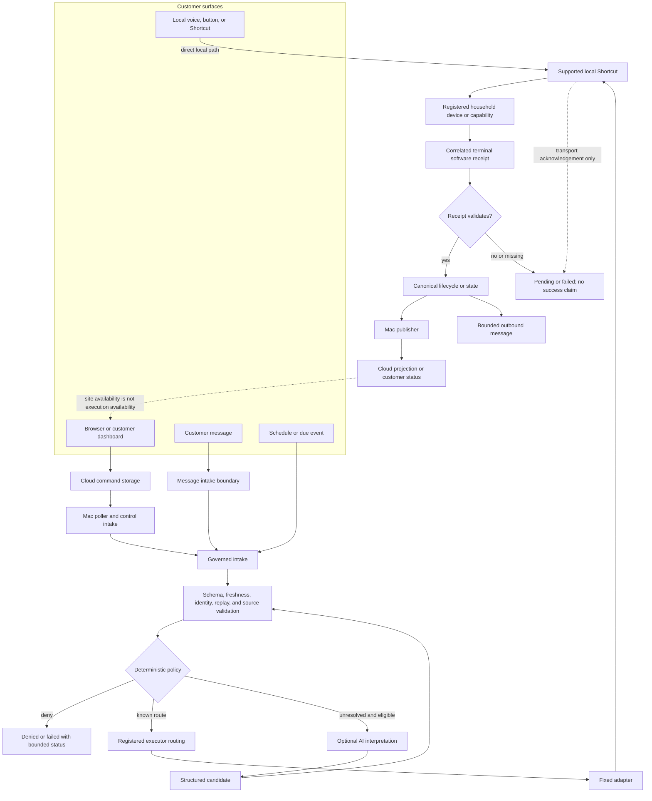

# Geoffrey Runtime and Jackson-West architecture

**Evidence snapshot: 8 November 2026**

This document is a public-safe map of the current local, governed, distributed, messaging, scheduling, and optional AI paths. It separates implemented behavior from isolated candidates and plans. It does not reproduce private runtime source, credentials, contacts, customer records, endpoints, or production identifiers.

## Responsibility boundaries

| Component | Responsibility | Not authority for |
|---|---|---|
| Geoffrey Runtime | Customer-facing experiences, public contracts, and supported local Shortcuts | Private governance or proof of every device effect |
| Jackson-West | Authentication, deterministic authorization, bounded routing, lifecycle state, and receipt validation for selected governed capabilities | Natural-language meaning outside validated contracts |
| Goldie / optional AI reasoning | Propose a structured interpretation when an eligible request has no deterministic interpretation | Authorization, recipient selection, direct device control, or success reporting |
| Apple Shortcuts and registered executors | Communicate with supported devices and perform the approved local capability | Policy ownership or automatic proof of the physical outcome |
| Receipts and publishers | Correlate software outcomes and project validated status | Inferring unobserved real-world state |
| Public site and cloud command storage | Present customer UI, store bounded commands, and expose sanitized projections | Household execution availability or AI reasoning |

Goldie reasons where an approved AI path is enabled. Jackson-West authorizes. Shortcuts communicate or execute. A receipt establishes what the governed software path reported; a separate observation or sensor is required to establish a physical-world effect.

## System architecture



The direct local path and the governed path are intentionally different. A supported local Shortcut can run without Jackson-West authorization and without a Jackson-West receipt. A remote or distributed request must pass the governed boundary before a registered executor may act.

## Operating modes

### Direct local execution

A person invokes a supported Shortcut on a local device. Device permissions and the Shortcut's own behavior govern that action. Owner observation currently reports working radio, lighting, scene, and coffee flows in selected local use. That report is useful operational evidence, but receipt and state semantics differ by capability and remain limited.

### Governed remote execution

An authenticated request reaches Jackson-West, which validates the request, applies deterministic policy, resolves an approved executor, and hands off only the bounded capability. Requester and executor can be different devices. Editable Shortcuts remain integration components, not the policy store.

### Distributed web execution

The source map is:

```text
browser
  -> cloud command storage
  -> Mac poller and control authorization
  -> registered household device or Shortcut
  -> correlated receipt
  -> Mac publisher
  -> cloud projection
```

The cloud site and command storage are separate from Goldie. A reachable website proves only that the web surface is reachable. It does not prove the Mac control plane is online or that a household action can execute. A Mac-offline end-to-end test has not been completed.

## Deterministic processing and AI fallback

Deterministic handlers are preferred whenever a validated target and action already map to an approved route. If an eligible request is unresolved, an AI worker may propose a bounded structured candidate. Identity, authorization, routing, and correlation values come from trusted runtime records, not from the model, and the candidate must pass the same deterministic validation before execution.

A disabled isolated candidate currently tests three levels:

1. tenant-scoped personalization;
2. learning only approved commands; and
3. owner-approved platform proposals.

The candidate has 32 passing isolated tests. It has no verified live integration and no verified background Goldie wake. Those test results support the staged design only; they do not establish production behavior.

## Customer messaging

Messaging has an intended full gateway and separately observed installed legs. They must not be described as one verified end-to-end route.

### Observed inbound leg

The current forwarding Shortcut takes the entire Shortcut Input, converts it to text, and forwards it to a fixed core destination. Older documentation that describes extraction of separate message and recipient fields is stale.

### Observed outbound leg

An installed dispatcher reads an executor selector and invokes a named Shortcut. The downstream Shortcut converts the supplied dictionary to text and sends to its fixed executor contact. A separate sender expects a message field and a customer field, but that sender was not observed as part of the installed dispatcher chain.

### Intended governed gateway

The staged gateway independently validates both the relay sender and the originating customer. Recipient selection must come from validated records; an untrusted request cannot supply an arbitrary destination. Relay identity, customer identity, and physical communications hardware are distinct concepts even when labels appear similar.

The relay gateway candidate and companion phone-executor candidate are disabled. The relay candidate has 41 passing isolated tests, including its earlier 28-test baseline. No full gateway round trip and no live multi-customer isolation test are verified.

## Household isolation

Isolation is enforced conceptually at every governed boundary: authenticated household and actor records, source and device-class checks, capability policy, registered executor resolution, request correlation, and receipt validation. Messaging adds independent relay-sender and originating-customer checks, and destinations must be derived from validated records.

This architecture is designed to avoid using a customer-supplied recipient or a human-readable device label as authority. However, unique physical-device identity, universal receiver-side enforcement, and a live end-to-end multi-household isolation demonstration remain unverified. Public documentation therefore describes the isolation controls as architecture and staged hardening, not as a completed production guarantee.

## Scheduling

A local schedule may invoke a supported Shortcut directly. A governed schedule is different: creation is authenticated and authorized, the stored action remains bounded by the existing frozen runtime contract, a due event wakes the governed lifecycle, and the action is revalidated before routing to a registered executor.

Dispatch or schedule creation is not completion. A transport acknowledgement may show that a handoff occurred; the schedule or action reaches an authoritative success state only when the capability's correlated terminal receipt satisfies its contract. This document does not restate or alter the exact frozen scheduling fields.

## Receipts and customer status

The evidence ladder is:

1. **Accepted:** intake and policy allowed the request.
2. **Dispatched:** a bounded request was handed to a registered executor.
3. **Terminal software receipt:** the matching executor reported a final result that passed receipt validation.
4. **Observed physical outcome:** a person or independent sensor confirmed the effect.

Only claim the highest level actually supported by evidence. A successful process return, a sent message, a website update, or a Shortcut handoff is not automatically a successful device effect. A terminal software receipt is authoritative for governed machine state where the contract defines it; it is not automatic proof that a light changed, audio was heard, or a device remained in that state.

## Current limits

- No full inbound-to-outbound customer gateway round trip is verified.
- No live multi-customer or multi-household isolation test is verified.
- The relay-gateway, phone-executor hardening, and three-level AI fallback candidates are staged and disabled.
- No verified live AI fallback integration or background Goldie wake exists.
- Website availability does not establish Mac or executor availability; the Mac-offline path is untested.
- Device registration does not yet establish hardware-backed unique physical-device identity.
- Recipient selection and receiver-side authorization must be enforced at the governed boundary; universal migration is not established.
- Receipt coverage differs by capability, and software receipts do not automatically prove physical state.
- Passing isolated suites do not establish production deployment, uptime, scale, or customer readiness.

## Status and evidence

See [evidence-boundaries.md](evidence-boundaries.md) for the capability-by-capability matrix. Dated case studies remain historical evidence at their original commits; this map does not rewrite their frozen claims or contracts.

## Public scope

This document intentionally omits private paths, endpoints, credentials, tokens, contact details, customer data, production identifiers, debug payloads, policy tables, and private runtime source. The descriptions are architectural summaries, not operating instructions or production records.
