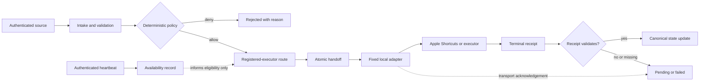
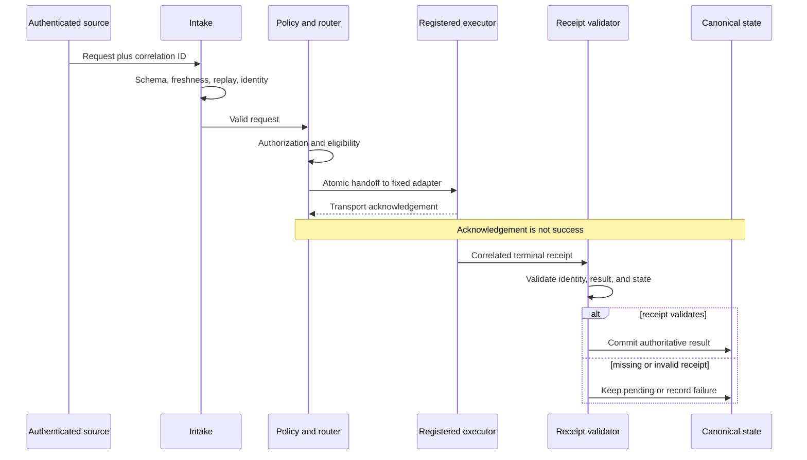

# Jackson-West architecture

Jackson-West separates control, execution, and evidence so that no single transport acknowledgement can be mistaken for an observed outcome.

The sanitized architecture has three planes:

- **Control plane:** authenticated intake, validation, deterministic policy, registered-executor routing, and atomic handoff.
- **Execution plane:** a fixed local adapter invokes Apple Shortcuts or another registered executor.
- **Evidence plane:** correlated terminal receipts govern canonical state, while owner observation remains separate corroboration.

Heartbeat records describe reachability and recovery; they do not grant authorization. Device registration currently represents an actor plus a device class, not hardware-backed identity. Geoffrey Runtime Access is an isolated candidate architecture, not evidence of universal production migration.

## System architecture

Editable source: [diagrams/sanitized-architecture.mmd](diagrams/sanitized-architecture.mmd)
Rendered diagram: [diagrams/sanitized-architecture.svg](diagrams/sanitized-architecture.svg)

## Request lifecycle

Editable source: [diagrams/request-lifecycle.mmd](diagrams/request-lifecycle.mmd)
Rendered diagram: [diagrams/request-lifecycle.svg](diagrams/request-lifecycle.svg)

## Public scope

These diagrams explain boundaries and state transitions. They do not reproduce production records, identifiers, endpoints, credentials, private source, or infrastructure topology.
